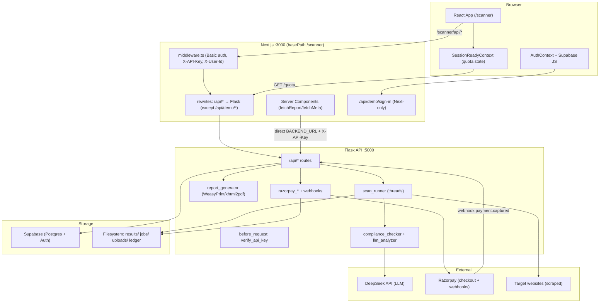
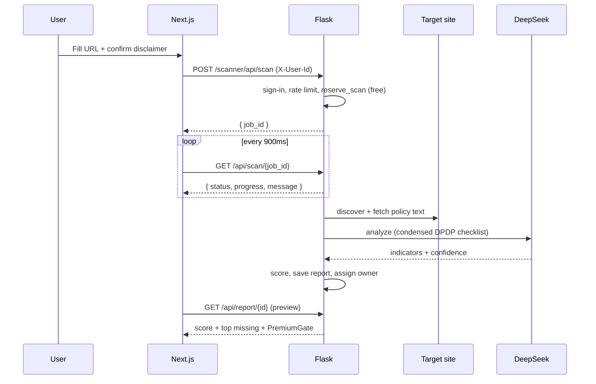
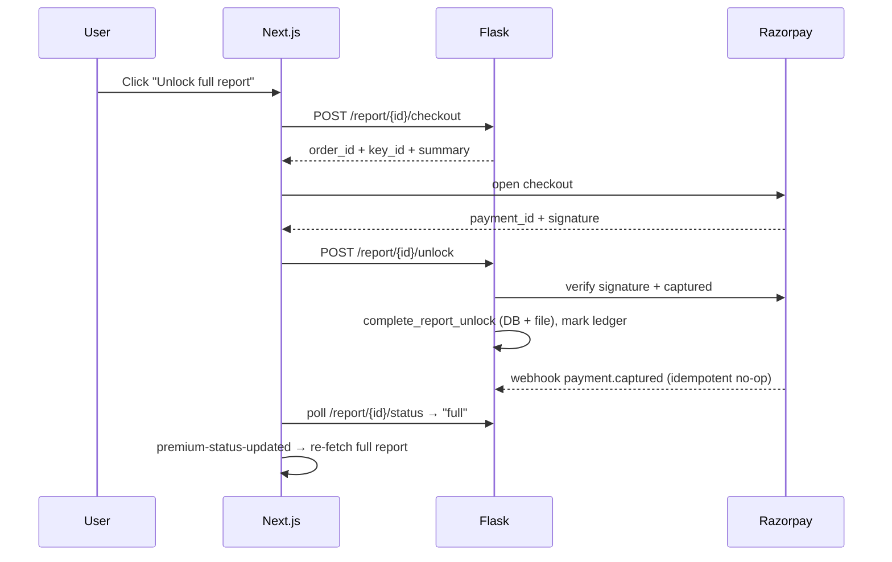
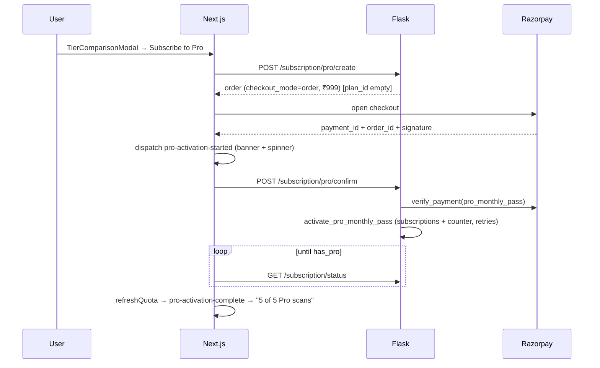

# DPDP Compliance Scanner — Complete Workflow & Architecture

> **Scope:** This document describes the *entire* workflow of the DPDP (Digital Personal Data
> Protection Act/Rules, 2025) Compliance Scanner — every subsystem, every request path, every
> scoring rule, every payment flow, and every piece of state — from a user typing a URL to a
> downloadable PDF report and a paid Pro subscription.
>
> **Two apps, one product:**
> - **Flask API** (Python) on port **5000** — scanning, scoring, PDF, payments, entitlements.
> - **Next.js UI** (TypeScript/React) on port **3000**, mounted at base path **`/scanner`** — proxies `/scanner/api/*` to Flask.
>
> **Persistence:** Supabase (Postgres + Auth) for accounts, quotas, unlocks, subscriptions; local
> filesystem for report JSON, job state, and the webhook idempotency ledger.

---

## Table of Contents

1. [High-Level Architecture](#1-high-level-architecture)
2. [Repository Layout](#2-repository-layout)
3. [Configuration & Environment Variables](#3-configuration--environment-variables)
4. [Data Model (Supabase Schema)](#4-data-model-supabase-schema)
5. [Request Lifecycle & Middleware](#5-request-lifecycle--middleware)
6. [The Scan Pipeline (Deep Dive)](#6-the-scan-pipeline-deep-dive)
7. [The DPDP Scoring Engine](#7-the-dpdp-scoring-engine)
8. [Confidence Refinement (Paid Scans)](#8-confidence-refinement-paid-scans)
9. [PDF Report Generation](#9-pdf-report-generation)
10. [Tiers, Quota & Entitlements](#10-tiers-quota--entitlements)
11. [Payments (Razorpay)](#11-payments-razorpay)
12. [Authentication](#12-authentication)
13. [Frontend Architecture & User Flows](#13-frontend-architecture--user-flows)
14. [Security](#14-security)
15. [Complete API Reference](#15-complete-api-reference)
16. [End-to-End Sequence Diagrams](#16-end-to-end-sequence-diagrams)
17. [Running the App](#17-running-the-app)

---

## 1. High-Level Architecture



**Two paths reach Flask:**
- **Browser** → `/scanner/api/*` → Next middleware (adds `X-API-Key`, resolves `X-User-Id` from Supabase session) → Next rewrite → Flask.
- **Server Components** (report page, meta) → direct to `BACKEND_URL` (`http://127.0.0.1:5000`) with the server-only API key.

The `/api/demo/*` path is deliberately **excluded** from the rewrite (regex `/api/:path((?!demo).*)`) so demo auto-login stays inside Next.js where the Supabase service-role key lives.

---

## 2. Repository Layout

```
dpdp_comp/
├── app.py                     # Flask entrypoint — all HTTP routes
├── config.py                  # Env-driven configuration (single source of truth)
├── auth.py                    # X-API-Key verification for /api/*
├── security.py                # SSRF URL validation + IP rate limiter
├── api_validation.py          # Server-side input validation (mirrors Zod)
├── api_handlers.py            # Report context builders (preview/full), PDF orchestration, meta
│
│  # ---- Scan pipeline ----
├── scan_runner.py             # Job orchestration (threads), save/load reports
├── scraper.py                 # requests + Selenium scraping, policy-link discovery
├── document_ingest.py         # PDF text extraction (pypdf)
├── utils.py                   # text cleaning, UA rotation, robots.txt, link scoring, chunking
├── compliance_checker.py      # DPDP indicators, weights, keyword gates, scoring
├── llm_analyzer.py            # DeepSeek expert analysis (OpenAI-compatible client)
├── confidence_refinement.py   # Extra-page fetch + re-analysis for paid scans <80% confidence
├── cache.py                   # 24h in-memory LLM result cache (per URL)
├── report_generator.py        # HTML→PDF (WeasyPrint preferred, xhtml2pdf fallback)
├── job_store.py               # File-backed job persistence (jobs/*.json)
│
│  # ---- Quota / entitlements ----
├── scan_quota.py              # quota_snapshot, reserve_scan, unlocks (public surface)
├── entitlements.py            # report ownership + premium access checks
├── supabase_entitlements.py   # Supabase CRUD: entitlements, scans, unlocks, visitors
├── supabase_subscriptions.py  # Supabase CRUD: Pro subscriptions + monthly scan counter
├── user_reconcile.py          # Sync file/DB unlock + quota state before reads
├── supabase_premium.py        # (legacy premium helpers)
├── payment_ledger.py          # Idempotency ledger (processed_webhook_payments.json)
│
│  # ---- Payments ----
├── razorpay_payments.py       # One-time orders (report unlock, paid scan, Pro monthly pass)
├── razorpay_subscriptions.py  # Recurring Razorpay subscriptions (Pro)
├── razorpay_webhooks.py       # Webhook signature verify + payment/subscription handlers
├── checkout_copy.py           # UI + Razorpay checkout copy per scope
│
│  # ---- Ops / scripts ----
├── wsgi.py, gunicorn.conf.py  # Production WSGI
├── activate_pro_manual.py     # Manual Pro activation (support tool)
├── create_demo_user.py        # Seed demo account
├── scripts/reset_all_data.py  # Wipe data
├── dpdp_rules.txt             # Full DPDP Rules (reference on disk; condensed version sent to LLM)
├── templates/                 # PDF HTML templates + letterhead asset
├── results/  jobs/  uploads/  # Runtime data (gitignored where appropriate)
├── supabase/schema.sql        # Postgres schema + RLS policies
│
└── web/                       # Next.js frontend
    ├── next.config.ts         # basePath /scanner, rewrites to Flask
    ├── scripts/dev.mjs        # Starts Flask + Next together (dev)
    ├── scripts/start.mjs      # Starts Gunicorn + Next (prod)
    ├── scripts/load-root-env.mjs
    └── src/
        ├── app/               # Routes (home, report, auth, legal, api/demo)
        ├── components/        # UI (home, report, premium, layout, auth, chat, cookies)
        ├── contexts/          # Auth, SessionReady, Theme, CookieConsent
        ├── hooks/             # Checkout hooks, nav status
        └── lib/               # api, quota, poll, razorpay, supabase, types
```

---

## 3. Configuration & Environment Variables

All backend config lives in `config.py`, read from environment / `.env`. Key values:

### Versions & metadata
| Var | Default | Meaning |
|-----|---------|---------|
| `SCANNER_VERSION` | `1.0.0` | Bumped when scoring/gates/prompts change |
| `RULES_VERSION` | `DPDP Rules 2025 (Nov 2025 Gazette)` | Shown on reports/PDF |

### Scan limits
| Var | Default | Meaning |
|-----|---------|---------|
| `SCAN_JOB_TIMEOUT_SECONDS` | `600` | Per-job watchdog timeout |
| `MAX_CONCURRENT_SCANS` | `3` | Global cap on running jobs |
| `RATE_LIMIT_SCANS_PER_HOUR` | `10` | Per client-IP scan starts |
| `RATE_LIMIT_ENABLED` | `1` | Toggle rate limiting |

### Auth
| Var | Meaning |
|-----|---------|
| `API_KEY` | If set, required on `/api/*` via `X-API-Key` or `Authorization: Bearer` |
| `APP_PASSWORD` | Optional HTTP Basic auth on the Next.js UI (set in `web/.env.local`) |
| `FLASK_SECRET_KEY` | Required in production (`FLASK_ENV=production`) |

### Tiers & pricing
| Var | Default | Meaning |
|-----|---------|---------|
| `PREMIUM_ENABLED` | `1` | Master paywall switch |
| `PREMIUM_FREE_ACCESS` | `0` | If `1`, everything unlocked (dev/testing) |
| `PREMIUM_PRICE_PAISE` | `29900` | ₹299 — one-time report unlock **and** pay-per-scan |
| `FREE_SCANS_PER_USER` | `1` | Lifetime free preview scans per account |
| `PREMIUM_PREVIEW_MISSING_INDICATORS` | `3` | # of missing indicators teased in preview |
| `PRO_SUBSCRIPTION_ENABLED` | `1` | Pro tier switch |
| `PRO_PRICE_PAISE` | `99900` | ₹999/month |
| `PRO_ORIGINAL_PRICE_PAISE` | `117500` | ₹1,175 struck-through (15% off badge) |
| `PRO_SCANS_PER_MONTH` | `5` | Pro monthly scan allowance |
| `RAZORPAY_PRO_PLAN_ID` | `""` | If empty → Pro uses **one-time ₹999 "monthly pass"** instead of a recurring subscription |
| `PREMIUM_CURRENCY` | `INR` | Currency |

### Razorpay
| Var | Meaning |
|-----|---------|
| `RAZORPAY_KEY_ID` / `RAZORPAY_KEY_SECRET` | API credentials |
| `RAZORPAY_WEBHOOK_SECRET` | Webhook signature secret (distinct from API secret) |

### Supabase
| Var | Meaning |
|-----|---------|
| `SUPABASE_URL` | Project URL |
| `SUPABASE_SERVICE_KEY` | Service role key (backend writes) |
| `SUPABASE_ANON_KEY` | Public anon key |
| `NEXT_PUBLIC_SUPABASE_URL` / `NEXT_PUBLIC_SUPABASE_ANON_KEY` | Browser Supabase client |

### LLM
| Var | Default | Meaning |
|-----|---------|---------|
| `DEEPSEEK_API_KEY` | — | Enables expert analysis; absent → keyword fallback |
| `DEEPSEEK_MODEL` | `deepseek-chat` | Model name |

### Frontend
| Var | Meaning |
|-----|---------|
| `BACKEND_URL` | Flask origin for Next rewrites/RSC (`http://127.0.0.1:5000`) |
| `NEXT_PUBLIC_DEMO_AUTO_LOGIN` | `1` enables demo auto sign-in |
| `NEXT_PUBLIC_DEMO_EMAIL` / password | Demo credentials |

---

## 4. Data Model (Supabase Schema)

Defined in `supabase/schema.sql`. All tables have Row-Level Security (RLS); the backend uses the
service key (bypasses RLS), while the browser only reads its own rows through anon-key policies.

| Table | Key columns | Purpose |
|-------|-------------|---------|
| **`user_scans`** | `(user_id, report_id)` unique; `url, score, verdict, scanned_at` | Every scan a signed-in user runs (history) |
| **`user_entitlements`** | PK `user_id`; `free_scans_used, scan_credits, pro_scans_used, pro_scans_reset_at` | Per-user quota counters |
| **`report_unlocks`** | `(user_id, report_id)` unique; `payment_id, order_id, amount_paise, currency, unlocked_at` | ₹299 one-time report unlocks |
| **`subscriptions`** | `(user_id, tier)` unique; `razorpay_subscription_id, razorpay_plan_id, status, current_start/end, charge_at, ended_at` | Pro subscription / monthly pass |
| **`visitor_scans`** | PK `visitor_id`; `scan_count, claimed_by_user_id` | Legacy anonymous-scan tracking |
| **`premium_grants`** | `payment_id` unique; `visitor_id, order_id, amount_paise` | Legacy visitor-based grants |

**Meaning of the entitlement counters:**
- `free_scans_used` — lifetime free previews consumed (cap = `FREE_SCANS_PER_USER`, default 1).
- `scan_credits` — **prepaid** pay-before-scan slots (₹299 each). Not bonus credits from unlocks.
- `pro_scans_used` — scans consumed this Pro billing period.
- `pro_scans_reset_at` — timestamp when `pro_scans_used` resets to 0 (subscription anniversary).

`subscriptions.status` allowed values: `created, authenticated, active, paused, halted, cancelled, completed, expired`. Only `active` counts as "has Pro". `tier` is `pro` (recurring) or `monthly_pass` value stored via `razorpay_subscription_id = pass_<order>` for the one-time-order Pro path.

---

## 5. Request Lifecycle & Middleware

### Flask (`app.py`)

**`@app.before_request → require_api_key`:**
- Skips `/health` and any non-`/api` path.
- Skips `/api/webhooks/razorpay` (authenticated by signature instead).
- Otherwise `verify_api_key(request)` — passes when `API_KEY` is unset, or matches `X-API-Key` / `Authorization: Bearer`.

**`@app.after_request` (two hooks):**
- `ensure_visitor_cookie` — sets an httponly `dpdp_vid` cookie on `/api` responses (16-byte token).
- `set_security_headers` — `X-Content-Type-Options`, `X-Frame-Options: DENY`, `Referrer-Policy`, a strict `Content-Security-Policy` (`default-src 'none'; frame-ancestors 'none'`), `Permissions-Policy`, and HSTS in production.

**Identity helpers:**
- `_user_id()` reads the `X-User-Id` header (set by Next middleware from the Supabase session, or forwarded by the browser).
- `_require_signed_in()` returns 401 `SIGN_IN_REQUIRED` when absent.
- `_visitor_id()` reads/creates the visitor cookie.

**Gates applied to `POST /api/scan`:** sign-in → rate limit (per IP) → quota reservation.

### Next.js (`middleware.ts`)
1. Redirect http→https in production.
2. Enforce `APP_PASSWORD` Basic auth (skipped for localhost internal proxy calls).
3. Redirect bare `/` and `/auth/*` (missing basePath) to `/scanner/...`.
4. On `/api/*`: inject `X-API-Key` and, from the Supabase session cookie, `X-User-Id`.
5. `Cache-Control: no-store` on `/report/*`.
6. Security headers; matcher excludes static assets.

---

## 6. The Scan Pipeline (Deep Dive)

### 6.1 Entry — `POST /api/scan`

`api_start_scan()` in `app.py`:
1. `_require_signed_in()` — must have `X-User-Id`.
2. `_apply_rate_limit()` — sliding-window per client IP (`RateLimiter`, default 10/hr).
3. `_scan_quota_gate()` → `reserve_scan(user_id, visitor_id)` — **consumes one slot** and returns its type: `free`, `prepaid`, or `pro`. If `prepaid` or `pro`, `auto_unlock = True` (the finished report is auto-unlocked to full).
4. Branch by content type:
   - `multipart/form-data` → `_start_pdf_scan()` (uploaded PDFs).
   - JSON/form → URL scan.

**URL scan validation:**
- `validate_scan_json_payload` — strips control chars, enforces lengths, validates `input_mode ∈ {url, pdf}`.
- `normalize_site_url` — prepends `https://` if missing, validates with `validators`.
- `validate_scan_url` (SSRF guard) — see [Security](#14-security).
- Optional manual policy URLs (`privacy_url`, `terms_url`, `cookie_url`) are normalized and SSRF-checked; passed as `privacy/terms/cookie` manual overrides.
- `start_scan(...)` spawns a background thread, returns `{ "job_id": ... }`.

**PDF scan (`_start_pdf_scan`):**
- Requires a `reference` label (org name/URL) and a **Privacy Policy PDF** (`privacy_pdf`); optional `terms_pdf`, `cookie_pdf`.
- Files must end `.pdf` and be non-empty; `start_pdf_scan(...)` spawns the job.

### 6.2 Job orchestration — `scan_runner.py`

- Jobs live in an in-memory dict (`_jobs`, guarded by a lock) **and** on disk (`jobs/<id>.json` via `job_store.py`) so status survives restarts and is shared across workers.
- `MAX_CONCURRENT_SCANS` enforced via `count_running_jobs()` before accepting a job.
- On import, `mark_stale_running_jobs()` fails any job left `running` by a prior process.
- Each job: `{ id, url, status, progress, message, log[], created_at, owner_user_id, auto_unlock_on_complete }`.
- `status(message, pct)` closure updates progress, appends a timestamped log line (last 50 kept), and calls `_timeout_guard` (raises `ScanTimeoutError` past `SCAN_JOB_TIMEOUT_SECONDS`).
- `_update_job` never downgrades a `complete`/`error` job back to `running`; `_normalize_job` recovers jobs stuck at 100%.

### 6.3 URL scan job — `run_scan_job()`

Progress milestones (roughly): 5 → init, 10 → discovery, 25 → method chosen, 28 → links, 40 → extraction, 50–58 → policy/terms/cookie text, 65 → analysis, 75 → LLM, 78–89 → refinement (paid), 92 → save, 100 → complete.

1. **Discovery** — `discover_policies(url, manual overrides)`:
   - Valid manual URLs take precedence. If **all three** are supplied, homepage discovery is skipped entirely (`method = manual`).
   - Otherwise fetch homepage with `requests` (retry w/ exponential backoff, respects robots.txt). If links still missing, fall back to **Selenium** (headless Chrome via `webdriver-manager`, stealth flags). Selenium also detects a **cookie banner** and its driver is kept alive for reuse.
   - `find_policy_links` scores anchors by regex on href + label, prioritizing `<footer>`/legal sections, penalizing auth/account links. Returns best `privacy/terms/cookie` URLs.
   - `method` ∈ `manual | requests | manual+requests | selenium | manual+selenium | failed`.
   - If discovery errored **and** no privacy link → job fails with a website-access error.
2. **Text extraction** — `fetch_policy_text(url, driver)` for privacy (required), terms, cookie:
   - Reuses Selenium driver if present, else `requests` → Selenium fallback.
   - `clean_text` strips scripts/styles; `clean_extracted_text` trims site chrome (start markers, nav phrases, HTML comments, whitespace).
   - Empty/short (<50 chars) extractions are logged as warnings.
3. **Analysis** — `run_compliance_check(...)` (see [§7](#7-the-dpdp-scoring-engine)).
4. **Refinement (paid only)** — if the reserved slot was `prepaid`/`pro` and confidence <80%, fetch extra pages and re-analyze (see [§8](#8-confidence-refinement-paid-scans)).
5. **Persist texts** — `stored_policy_text/terms/cookie` (≤500k chars each) saved into `analysis_details` for PDF regeneration without re-scraping.
6. **Save report** — `save_report()` writes `results/<domain>_<timestamp>.json`; the filename stem is the `report_id`.
7. **Finalize access** — `_finalize_scan_access()`:
   - `assign_report_owner()` — records the scan in `user_scans` and stamps `owner_user_id` on the JSON.
   - If `auto_unlock_on_complete` → `unlock_prepaid_scan_report()` grants a permanent `report_unlocks` row (full report, no extra charge).
8. `finally:` Selenium driver is quit.

### 6.4 PDF scan job — `run_pdf_scan_job()`

- Saves each uploaded PDF under `uploads/<job_id>/`, extracts text via `extract_text_from_pdf` (pypdf; ≤15 MB; must yield ≥50 chars).
- `scraping_method = "pdf_upload"`, `cookie_banner = False`, policy "links" are display labels (`Uploaded: <file>`).
- Same analysis → save → finalize path as URL scans.

### 6.5 Status polling — `GET /api/scan/<job_id>`

Returns `{ id, status, progress, message, log, error }`. When `complete`, also `{ redirect: /report/<id>, report_id, score, verdict, url }`, and re-asserts report ownership.

---

## 7. The DPDP Scoring Engine

Implemented in `compliance_checker.py` with LLM analysis in `llm_analyzer.py`.

### 7.1 The 10 indicators, weights & rule citations

| Indicator | Weight | DPDP Rule |
|-----------|-------:|-----------|
| `notice_consent_purpose` | **25** | Rule 3 — Notice by Data Fiduciary |
| `data_principal_rights` | **20** | Rule 14 — Rights of Data Principals |
| `grievance_officer_contact` | **20** | Rule 9 + Rule 14(3) — Grievance Redressal |
| `parental_consent_children` | 10 | Rule 10 — Verifiable Parental Consent |
| `consent_manager_mentioned` | 5 | First Schedule Part B |
| `cross_border_transfer` | 5 | Rule 15 — Transfer Outside India |
| `data_retention_period` | 5 | Third Schedule — Retention |
| `dpdp_act_reference` | 5 | Act/Rules reference |
| `privacy_policy_exists` | 5 | Baseline |
| `cookie_banner` | 5 | Optional consent mechanism |

**Total = 100.** Verdict thresholds: **≥80 → "Likely Compliant"**, **50–79 → "Partially Compliant"**, **<50 → "Likely Non-Compliant"**.

### 7.2 Two scoring paths

`run_compliance_check` decides the engine:

**A) DeepSeek expert (primary)** — `analyze_with_deepseek_expert()`:
- System prompt embeds a **condensed DPDP checklist** (~1,800 tokens; full gazette text stays on disk in `dpdp_rules.txt` and is *not* sent to the API for cost reasons).
- Per indicator the LLM must return `status (Found|Partial|Missing)`, `confidence (0–100)`, verbatim `excerpt`, `analysis` (with rule citation), and `recommendation`.
- `temperature=0.1`, `max_tokens=4096`, 120s timeout, **3 retries** with 1/2/4s backoff.
- JSON is repaired (strip fences, trailing commas, unescaped newlines) then validated & normalized:
  - Missing → confidence forced to 0.
  - **Excerpt verification** — each excerpt must appear (exact, case-insensitive, or ≥0.8 fuzzy overlap via `SequenceMatcher`) in the source text; unverifiable excerpts are replaced by a keyword-anchored sentence, or `[Excerpt not verifiable in original text]`.
- Result cached 24h per normalized URL (`cache.py`).
- Scoring — `calculate_compliance_score_from_llm()`:
  - `Found` → `weight × confidence/100`; `Partial` → `weight × 0.8 × confidence/100`; `Missing` → 0.
  - `cookie_banner` added separately if detected during scrape (not in LLM JSON).
  - LLM's own `overall_score` is **ignored**; the score is summed from indicator points, rounded, capped 0–100.
  - **Confidence summary** — average confidence across non-Missing indicators → label `high` (≥80) / `medium` (≥50) / `low`; stored in `confidence_label` + `average_confidence` (used internally for refinement; not surfaced in the UI/PDF).

**B) Keyword fallback** — when DeepSeek is unconfigured or fails after retries:
- `calculate_compliance_score()` awards ~60% of each weight when statutory keywords are present.
- Grievance contact gets full points if regex finds an email/phone near "grievance"/"DPO" (`find_grievance_officer_contact_improved`, ±150 char window) or AI confidence >0.9.
- Binary points for privacy-policy-exists and cookie-banner.

### 7.3 Anti-hallucination keyword gates

`apply_keyword_gates()` zeroes AI scores unsupported by statutory language (used on the legacy AI-scores path; the LLM excerpt-verification serves the equivalent role on the primary path):
- **Rule 3 gate** — requires `consent` **and** ≥2 of: "itemised description", "specified purpose", "withdraw", "data principal".
- **Rule 14 gate** — requires ≥2 exact phrases (right to access/correction/erasure, grievance redressal, nominate).
- **Retention gate** — a time period (e.g. "90 days", "three years") must appear within ±100 chars of retain/retention/erased.
- Standard gates — consent manager, data fiduciary, DPDP Act reference, parental consent, cross-border, grievance officer each require ≥1 statutory keyword.

### 7.4 Report object

`ComplianceReport.to_dict()` persists: `url, timestamp, score, verdict, privacy_policy_found, cookie_banner_found, grievance_officer_contact, ai_indicators, rule_indicators, score_breakdown, rule_citations, errors, scraping_method, ai_available, scanner_version, rules_version, confidence_label, average_confidence, analysis_details` (which holds `llm_analysis`, stored texts, policy URLs, scan steps, chunk info).

---

## 8. Confidence Refinement (Paid Scans)

`confidence_refinement.py` — only for **paid** scans (`prepaid`/`pro` slot) whose average LLM
confidence is **< 80%**:

1. `should_refine_confidence(llm_result, is_paid_scan)` computes the non-Missing average; returns `(True, avg)` when < 80.
2. `fetch_additional_context_pages(url, max_pages=3, driver)` fetches up to 3 same-domain pages from candidates `/about, /about-us, /contact, /contact-us, /legal, /disclaimer, /terms, /` (skips the original URL, needs >100 chars each), reusing the Selenium driver.
3. The combined `original + additional` text is re-analyzed via `run_compliance_check` again.
4. Progress messages surface the before/after confidence; **no extra credits are consumed** (refinement happens inside the same job).

This improves accuracy for customers who paid, without changing the score for free previews.

---

## 9. PDF Report Generation

`report_generator.py` + `api_handlers.generate_report_pdf()`:

- **Backends:** WeasyPrint preferred; on Windows (no GTK) falls back to **xhtml2pdf** (pure Python, uses a `fast_pdf` plain-text mode for very long policies). Backend chosen once and cached (`_weasyprint_available`).
- **Text source for PDF** — `_resolve_policy_texts_for_pdf()` prefers `stored_policy_text/terms/cookie` saved at scan time, so downloads don't re-scrape (which could time out); falls back to re-extracting uploaded PDFs, then re-fetching policy URLs.
- **Content:** branded letterhead cover (base64 PNG), score & verdict, per-indicator table (Found/Partial/Missing with status CSS classes), rule citations, prioritized recommendations (`RECOMMENDATIONS` map with Mandatory vs Best-practice), and a **Turnitin-style evidence section** highlighting matched policy passages (char-limited to 10k for xhtml2pdf performance).
- **Mandatory indicators** (`MANDATORY_INDICATORS`): notice/consent, data-principal rights, grievance officer, privacy-policy-exists — prioritized in the free-preview "top missing" teaser and remediation ordering.
- **Access:** `GET /api/report/<id>/pdf` — 402 `PREMIUM_REQUIRED` unless the caller has full access; returns `DPDP_Report_<domain>_<ts>.pdf`.

---

## 10. Tiers, Quota & Entitlements

### 10.1 Tiers

| Tier | Price | Grants |
|------|-------|--------|
| **Free** | ₹0 | `FREE_SCANS_PER_USER` (1) lifetime **preview** scans (score + top-3 missing only) |
| **One-Time Report** | ₹299 | Permanently unlocks the **full** report + PDF for one report |
| **Pay-per-scan (prepaid)** | ₹299 | Run one new scan when free quota is exhausted; **auto-unlocked** to full on completion |
| **Pro** | ₹999/mo | `PRO_SCANS_PER_MONTH` (5) full-report scans per period; auto-unlock; resets monthly |

### 10.2 `quota_snapshot(user_id, visitor_id)` — the UI's source of truth

Calls `reconcile_user_account` first, then returns:
`signed_in, free_scans_limit/used/remaining, prepaid_scans (=scan_credits), pro_scans_remaining, has_pro, can_scan, requires_sign_in, message, unlocked_report_ids`.

`can_scan = free_remaining > 0 OR prepaid > 0 OR pro_remaining > 0`.

### 10.3 Slot consumption priority — `consume_user_scan()`

When a scan is reserved, slots are consumed in order: **Pro → Free → Prepaid**.
- Pro: if active subscription and `pro_scans_remaining > 0` → `consume_pro_scan()` increments `pro_scans_used`.
- Free: `free_used < limit` → increment `free_scans_used`.
- Prepaid: `scan_credits > 0` → decrement.
- Upserts are **partial** (only the fields being changed) to avoid clobbering unrelated counters — this was the fix for the "prepaid credit disappears" and "Pro not activating" bugs.

### 10.4 Reconciliation — `user_reconcile.py`

`reconcile_user_account(user_id)` runs before quota reads and report views:
- `list_unlocked_report_ids_for_user` — merges DB unlocks with file-based unlocks (backfilling `report_unlocks` from report JSON when needed).
- `sync_entitlements_from_scans` — raises `free_scans_used` to match saved scans when entitlements are stale (never for Pro users; never overwrites prepaid credits).
- `sync_pro_scan_usage` — aligns `pro_scans_used` with scans made during the Pro period (fixes Pro scans mis-counted as free).

### 10.5 Report access — `entitlements.has_premium_access` / `user_has_report_access`

Full access is granted when: paywall disabled, `PREMIUM_FREE_ACCESS`, an explicit `report_unlocks` row exists, the report JSON is flagged `premium_unlocked` for this user, **or** the user has active Pro **and owns** the report. Otherwise the report is served as a **preview** (`build_preview_context`) with locked indicators/PDF.

Every report read/PDF/checkout first runs `report_view_denied()` — non-owners and anonymous viewers get 403 `SIGN_IN_REQUIRED`.

---

## 11. Payments (Razorpay)

Three purchase types, each with a **client-confirm** path *and* a **webhook** path, made idempotent by
the local ledger (`payment_ledger.py`, `processed_webhook_payments.json`) and unique DB constraints.

### 11.1 Order scopes

Orders carry a `notes.scope` used to route confirmation:
| Scope | Amount | Created by |
|-------|--------|-----------|
| `report` | ₹299 | `create_checkout_order(report_id, user_id)` |
| `paid_scan` | ₹299 | `create_paid_scan_order(user_id)` |
| `pro_monthly_pass` | ₹999 | `create_pro_monthly_pass_order(user_id)` |

Recurring Pro (when `RAZORPAY_PRO_PLAN_ID` is set) uses a Razorpay **Subscription** instead (`create_pro_subscription`, `checkout_mode = subscription`).

### 11.2 One-time report unlock (₹299)

1. `POST /api/report/<id>/checkout` → `create_checkout_order` (returns order + `checkout_summary("report")` copy). Already-unlocked short-circuits.
2. Browser opens Razorpay; on success `POST /api/report/<id>/unlock` with `payment_id/order_id/signature`.
3. `verify_payment(expected_scope="report")` — verifies signature, that payment is `captured`, and matches the order.
4. Idempotency check (ledger + `payment_id_in_report_unlocks`).
5. `complete_report_unlock()` — flags the report JSON (`grant_premium_access`) and inserts a `report_unlocks` row; `mark_payment_processed`.

### 11.3 Pay-per-scan (prepaid ₹299)

1. `POST /api/scan/checkout` (only when free quota exhausted) → `create_paid_scan_order`.
2. Success → `POST /api/scan/confirm-payment`.
3. `verify_payment(expected_scope="paid_scan")` → `confirm_prepaid_scan_payment()` → `grant_prepaid_scan()` increments `scan_credits` (partial upsert) → `mark_payment_processed`.
4. The next scan consumes the prepaid slot and auto-unlocks its report.

### 11.4 Pro subscription (₹999/mo)

**Create** — `POST /api/subscription/pro/create`:
- Rejects if already `active` (`ALREADY_SUBSCRIBED`).
- If `RAZORPAY_PRO_PLAN_ID` empty → **monthly pass** one-time ₹999 order (`checkout_mode: order`).
- Else → recurring Razorpay **Subscription** (`checkout_mode: subscription`, `total_count: 12`).

**Confirm** — `POST /api/subscription/pro/confirm`:
- **Monthly-pass branch** (has `order_id`): `verify_payment(expected_scope="pro_monthly_pass")` → `activate_pro_monthly_pass()` → upserts a `subscriptions` row (`tier=pro`, `status=active`, 1-month window, `razorpay_subscription_id = pass_<order>`) + `initialize_pro_subscription_scans()` (resets counter, sets `pro_scans_reset_at` to +1 month). `upsert_subscription` retries 3× on transient Supabase errors.
- **Subscription branch** (has `subscription_id`): `verify_subscription_payment` (signature) → `fetch_subscription` → verify `notes.user_id` matches → upsert subscription with Razorpay timestamps → `initialize_pro_subscription_scans`.
- Ledger-marked; returns fresh `quota`.

**Status** — `GET /api/subscription/status` → `{ has_pro, pro_subscription, pro_scans_remaining }` (frontend polls this after payment).

**Cancel** — `POST /api/subscription/cancel` → Razorpay cancel (recurring only).

**Monthly reset** — `get_pro_scans_remaining()` returns `PRO_SCANS_PER_MONTH − pro_scans_used`; when `now ≥ pro_scans_reset_at` it calls `reset_pro_scan_counter()` (used→0, next reset +1 month, anniversary model — can't be gamed by subscribing at month-end).

### 11.5 Webhook (primary confirmation) — `POST /api/webhooks/razorpay`

- Authenticated by `X-Razorpay-Signature` (HMAC-SHA256 of raw body with `RAZORPAY_WEBHOOK_SECRET`), **not** the API key. Handler errors return 200 (logged) so Razorpay doesn't retry forever on our bugs.
- `handle_webhook_event` dispatches:
  - **`payment.captured`** → `process_payment_captured()` reads the order's `notes.scope` and applies `report` unlock / `paid_scan` grant / `pro_monthly_pass` activation. Fully idempotent (ledger + DB checks).
  - **`subscription.*`** → `process_subscription_event()` upserts the subscription row; on `subscription.activated`/`charged` (active) it initializes the scan counter.

The webhook and the client-confirm endpoints are redundant on purpose: whichever arrives first wins, the other becomes a no-op.

---

## 12. Authentication

- **Provider:** Supabase Auth (email/password + magic-link/OAuth callback). Backend trusts the
  `X-User-Id` header injected by Next middleware from the validated Supabase session; the browser
  also forwards it (rewrites can strip middleware headers).
- **`AuthContext`** (frontend): bootstraps `getSession()`, exposes `signIn/signUp/resendConfirmation/requestPasswordReset/updatePassword/signOut/openAuth/closeAuth`, and reacts to `onAuthStateChange` (`SIGNED_IN` claims prior visitor scans + fires `premium-status-updated`; `SIGNED_OUT` on a report page redirects home).
- **Callback** — `/scanner/auth/callback` exchanges the code for a session; recovery links route to `/auth/reset-password`; success/failure redirect to `/?auth=confirmed|failed`.
- **Demo mode** — when `NEXT_PUBLIC_DEMO_AUTO_LOGIN=1`, the client hits the Next-only `/api/demo/sign-in` (admin `generateLink` with service key) → `verifyOtp`, or falls back to email/password.
- **`APP_PASSWORD`** — optional site-wide HTTP Basic gate in Next middleware (skipped for internal localhost proxy calls).

---

## 13. Frontend Architecture & User Flows

### 13.1 Stack & provider tree
- **Next.js 15.1 / React 19**, Tailwind 3.4, framer-motion, lucide-react, Zod, Supabase SSR.
- `AppShell` provider order: `SplashLoader → AuthProvider → SessionReadyProvider → ThemeProvider → CookieConsentProvider → (SiteHeader, DemoBanner, DisclaimerBar, AuthNotice, main→WorkspaceReadyGate→children, SiteFooter, LexBot)`.

### 13.2 API/session libs
- `lib/api.ts` — `clientApiBase = "/scanner/api"`, `userApiHeaders(userId)`; server-side `fetchReport/fetchMeta/fetchHistory/fetchPreviousScan` (direct to Flask with server API key, cached).
- `lib/quota.ts` — `fetchQuotaClient`, `fetchNavPremiumStatus`, `claimVisitorScanClient`.
- `lib/scan-poll.ts` — `pollScanStatus` (900ms interval, up to 10 transient retries with backoff).
- `lib/payment-poll.ts` — `pollReportUnlocked`, `pollPrepaidScanGranted`, `pollProSubscriptionActive` (1500ms, 90s timeout) + `tryClient*Confirm` helpers.
- `SessionReadyContext` — holds `quota`, `quotaLoading`, `proActivating`; `refreshQuota()`; listens for `premium-status-updated`, `pro-activation-started/complete`.

### 13.3 Event bus (decouples hooks)
| Event | Dispatched by | Consumed by |
|-------|---------------|-------------|
| `premium-status-updated` | sign-in, every checkout hook | SessionReady, ReportViewGuard, nav status |
| `pro-activation-started` / `-complete` | `useProSubscriptionCheckout` | SessionReady (`proActivating` banner) |
| `scan-history-updated` | `ScanForm` after save | `UserHistoryPanel` |
| `route-start` | pre-report navigation | `RouteProgress` |
| `dpdp-open-lexbot` | any | `LexBot` |

### 13.4 Scan UI — `ScanForm`
State machine: `mode (url|pdf) → submit → require sign-in → quota check → AssessmentDisclaimerModal → startAssessment (POST /scan) → pollScanStatus → save history → refreshQuota → router.push(/report/:id)`. Active scan is stashed in `sessionStorage (dpdp:active-scan, 30-min TTL)` so a refresh reconnects polling. Quota-exhausted submits trigger `usePaidScanCheckout`.

### 13.5 Report UI
- Server page `report/[id]/page.tsx` calls `fetchReport` (403→redirect home, 404→notFound) then renders `ReportViewGuard`.
- `ReportViewGuard` re-verifies via `GET /report/:id` (defense-in-depth), re-fetches on `premium-status-updated`, clears sensitive state on bfcache events.
- `ReportView` renders **preview** (score, top-missing, discovered pages, `PremiumGate`) vs **full** (all indicators, findings, analysis, `RemediationPlan`, breakdown). `ScoreGauge` animates the radial score. `PremiumPdfButton` links to the PDF when unlocked, else triggers checkout. `RemediationPlan` persists a checklist in localStorage (gated on functional cookie consent).

### 13.6 Payments UI
Three hooks share the pattern **create order → `CheckoutSummaryModal` → Razorpay → client confirm → poll → `premium-status-updated`**:
- `usePremiumCheckout(reportId)` — report unlock.
- `usePaidScanCheckout()` — prepaid scan (baselines `prepaid_scans`, polls until it increments).
- `useProSubscriptionCheckout()` — Pro; dispatches `pro-activation-started` (shows an "Activating Pro…" banner and keeps the modal open), retries confirm once after 1.5s, polls `/subscription/status`, then `refreshQuota({blocking:true})` and `pro-activation-complete`.
- `TierComparisonModal` (Free vs Pro) opened by the header `PremiumTierButton`.

### 13.7 Other UI
`SiteHeader/Footer`, `UserHistoryPanel`/`HistorySidebar` (sparklines, verdict, lock icons), `LexBot` (client-only DPDP FAQ bot, localStorage chat, no backend), `CookieConsentContext` (auto-accepts functional, banner removed), `ThemeContext`/`ThemeToggle` (dark default, SSR-safe), `DemoBanner`, legal pages.

---

## 14. Security

- **SSRF guard** (`security.validate_scan_url`) — only http/https, ports 80/443, no embedded creds, blocks `localhost`/`*.local`/metadata hosts, resolves DNS and rejects any A/AAAA in private/reserved ranges (10/8, 127/8, 169.254/16, 172.16/12, 192.168/16, 100.64/10, ::1, fc00::/7, fe80::/10). Applied to the scan URL *and* every manual policy URL. Max URL length 2048.
- **Rate limiting** — in-memory sliding window per client IP (`X-Forwarded-For`-aware); `MAX_CONCURRENT_SCANS` caps parallel jobs. (Use a single Gunicorn worker for accurate in-memory limits.)
- **API key** — `X-API-Key`/Bearer on `/api/*` when `API_KEY` set; Next middleware injects it so the browser never holds it.
- **Webhook signature** — HMAC-SHA256 constant-time compare.
- **Payment idempotency** — file ledger + unique DB constraints; scope checks prevent a ₹299 payment being replayed as Pro, etc.
- **Input validation** — `api_validation.py` strips control chars, enforces lengths, whitelists `input_mode`; PDF uploads must be `.pdf`, non-empty, ≤15 MB.
- **Access control** — `report_view_denied` (ownership) on every report route; previews omit protected fields **server-side** (never sent to unauthorized clients).
- **Headers** — strict CSP, `X-Frame-Options: DENY`, nosniff, referrer policy, HSTS (prod), no-store on report pages.
- **Secrets** — DeepSeek/API-key patterns redacted in logs; service key stays server-side.

---

## 15. Complete API Reference

Base: Flask `/api` (browser reaches it via `/scanner/api`).

| Method | Path | Auth | Purpose |
|--------|------|------|---------|
| GET | `/health` | none | Meta + status |
| GET | `/api/health/supabase` | key | Supabase table check |
| GET | `/api/quota` | key | Quota snapshot (+ premium meta) |
| GET | `/api/meta` | key | Versions, pricing, flags |
| GET | `/api/user/nav-status` | key | Premium nav badge |
| GET/POST | `/api/user/scans` | sign-in | List / save scan history |
| POST | `/api/quota/claim` | sign-in | Claim prior anonymous scan |
| POST | `/api/scan` | sign-in + rate + quota | Start URL or PDF scan |
| GET | `/api/scan/<job_id>` | key | Poll scan progress/result |
| GET | `/api/history` | key | Recent public reports (12) |
| GET | `/api/report/<id>` | owner | Full or preview report context |
| GET | `/api/report/<id>/status` | owner | `access_tier` for unlock polling |
| GET | `/api/report/<id>/previous` | owner | Prior scan for trend |
| GET | `/api/report/<id>/pdf` | full access | Download PDF (402 if locked) |
| POST | `/api/report/<id>/checkout` | sign-in | ₹299 report-unlock order |
| POST | `/api/report/<id>/unlock` | sign-in | Verify payment, unlock report |
| POST | `/api/scan/checkout` | sign-in | ₹299 pay-per-scan order |
| POST | `/api/scan/confirm-payment` | sign-in | Verify payment, grant prepaid scan |
| POST | `/api/subscription/pro/create` | sign-in | Create Pro order/subscription |
| POST | `/api/subscription/pro/confirm` | sign-in | Verify + activate Pro |
| GET | `/api/subscription/status` | sign-in | Pro status + remaining scans |
| POST | `/api/subscription/cancel` | sign-in | Cancel recurring Pro |
| POST | `/api/webhooks/razorpay` | signature | Primary payment confirmation |

Error codes: `SIGN_IN_REQUIRED` (401), `SCAN_QUOTA_EXCEEDED` (403), `PAYMENT_INVALID` (402), `PAYMENT_FAILED`/`CHECKOUT_FAILED`/`SUBSCRIPTION_FAILED` (502), `PAYMENTS_UNAVAILABLE`/`PRO_UNAVAILABLE` (503), `ALREADY_SUBSCRIBED` (400), `PREMIUM_REQUIRED` (402), `PRO_ACTIVATION_FAILED` (500).

---

## 16. End-to-End Sequence Diagrams

### 16.1 Free scan → preview report



### 16.2 Report unlock (₹299)



### 16.3 Pro subscription (monthly pass)



---

## 17. Running the App

### Development
```bash
cd web
npm install
npm run dev      # starts Flask :5000 + Next :3000 together (scripts/dev.mjs)
```
Open **http://localhost:3000** (redirects to `/scanner`).

`scripts/dev.mjs` frees ports 3000/5000, merges env from `../.env` + `web/.env.local`, waits for
Flask `/health` and the Next root, then warms the home page.

### Production
```bash
cd web
npm run build
npm run start    # Gunicorn (app:app) :5000 + next start :3000 (scripts/start.mjs)
```
Requires `FLASK_SECRET_KEY`. Use one Gunicorn worker if relying on the in-memory rate limiter.

### One-time setup
1. Create the Supabase project; run `supabase/schema.sql`; enable Email auth + set redirect URLs.
2. Set `.env` (backend) and `web/.env.local` (frontend) — Supabase keys, Razorpay keys + webhook secret, `DEEPSEEK_API_KEY`.
3. In Razorpay, add a webhook to `/api/webhooks/razorpay` for `payment.captured` (and `subscription.*` if using recurring Pro); set `RAZORPAY_WEBHOOK_SECRET`.
4. (Optional) Create a ₹999 monthly plan and set `RAZORPAY_PRO_PLAN_ID` for true recurring billing; otherwise Pro uses the one-time monthly-pass order.

### Support tooling
- `activate_pro_manual.py <user_id>` — manually activate Pro (payment succeeded but activation failed).
- `create_demo_user.py` — seed the demo account.
- `scripts/reset_all_data.py` — wipe local data.

---

*Generated from a full read-through of the backend (`app.py`, scan pipeline, scoring engine, quota,
payments, security) and a thorough exploration of the Next.js frontend. Bump `SCANNER_VERSION` and
this document together when scoring rules, gates, or prompts change.*
